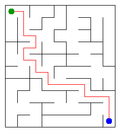

# Assignment 3. Maze Escape

Student ID: 252864
Name: Yerdaulet Yerboluly
Group: SE-2519
Maze size (rows x columns): 9 x 10

This file is the report. Fill it in as you go. How to start: `START_HERE.md`. The task: `docs/Assignment3.pdf`.

## Program output

The 13 lines your program prints on your data (`java -cp out Main`):

    Broken: 89
    Kept: 72
    Last broken wall: 125
    MST cost: 26882
    Heaviest broken wall: 774
    Path length: 19
    DFS visited: 59
    Dead ends: 24
    Zones: 10
    Largest zone: 18
    Is DAG: 0
    Flow stages: 8
    Fastest route cost: 3

My maze:

## Questions

Answer in your own words, two or three sentences each.

Mission 0. `find` returns the root of the set that contains a cell, and `union` joins two different sets. Path compression makes visited nodes point directly to the root, while union by size attaches the smaller tree under the larger one.

Mission 1. The finished maze is a spanning tree of `R*C` cells, and every tree with `R*C` vertices has `R*C - 1` edges, so this many walls are broken. The grid starts with `R*(C-1) + C*(R-1)` inner walls; subtracting `R*C - 1` gives `(R-1)*(C-1)` walls kept.

Mission 2. Kruskal and Prim both gave an MST cost of `26882`. They choose edges in different ways, but both algorithms produce a minimum spanning tree, so their total minimum cost is equal.

Mission 3. The maze is connected and has no cycle because it is a tree, so there is exactly one path between any two cells. I used my own arrays as an iterative DFS stack instead of recursive calls, so a large maze cannot overflow the Java call stack.

Mission 4. The reversed graph lets the second pass collect one whole strongly connected component without moving into a component that should be processed later. Since there are no slides from a cell to itself, a cycle exists exactly when some zone has more than one cell; therefore there is no cycle when every cell is its own zone and `Zones` equals the number of cells.

Mission 5. Kosaraju numbers the zones in topological order, so every edge between zones goes from a smaller number to a larger number. When I process a zone, all routes into it are already known; the pass takes `O(z + e)` time, where `z` is the number of zones and `e` is the number of edges between them.

## AI use

I used ChatGPT to explain the algorithms, help draft their implementation, review the code and find errors. I read the code, tested it on the provided examples and checked the results myself.

## Timing (Mission 7)

Milliseconds, 5 runs each, from `java -cp out Bench`.

| maze | Kruskal | Prim |
|---|---|---|
| 100 x 100 | 18 ms | 10 ms |
| 300 x 300 | 76 ms | 63 ms |
| 1000 x 1000 | 1163 ms | 1769 ms |

Both algorithms become much slower as the number of cells and walls grows. On the largest maze, sorting all walls made Kruskal take about 1.2 seconds, while the many priority queue operations made Prim take about 1.8 seconds on my computer.

## Complexity

n is the number of cells, m the number of walls (or slides). Fill in every algorithm you wrote.

| algorithm | time | space | assumptions |
|---|---|---|---|
| DSU find and union | amortized `O(alpha(n))` | `O(n)` | union by size and path compression |
| Kruskal | `O(m log m)` | `O(n + m)` | walls are sorted by cost |
| Prim | `O(m log n)` | `O(n + m)` | binary priority queue and a connected graph |
| DFS | `O(n + m)` | `O(n)` | adjacency lists and an iterative stack |
| Kosaraju | `O(n + m)` | `O(n + m)` | adjacency lists for the graph and its reverse |
| Route in the zone graph | `O(n + m)` expected | `O(n + m)` | topological zone order and average `O(1)` hash map operations |

## Before you submit

- data/walls.txt, data/slides.txt and output/maze.png are in the repository.
- `java tools/Check.java` shows all examples right.
- This README is filled in, the program output and the section AI use included.
- The work is pushed to main (at least one commit per mission) and the repository is public.
- The link is attached in Moodle.
